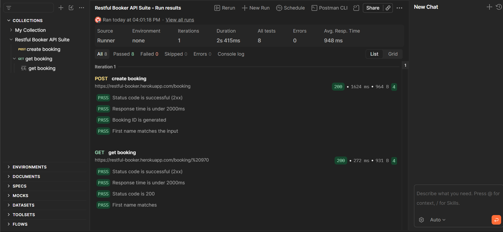

# 🚀 API Testing Portfolio: Restful Booker

**Tester:** Samukelo Cele
**Tools Used:** Postman, Python, Pytest, requests, GitHub Actions (CI/CD)

## 📝 Project Overview
This repository contains a complete API testing portfolio for the **Restful Booker API**. It demonstrates manual API testing (using Postman) and automated API testing (using Python, Pytest, and GitHub Actions).

## 📂 Repository Structure
*   **`/Postman`**: Contains the manual Postman collection and evidence of the collection runner passing 8 assertions.
*   **`/Python-Automation`**: Contains the automated Pytest script and CI/CD pipeline configuration.

## 🧪 Test Coverage
Both suites cover the following API operations:
1.  **POST /booking:** Creates a new booking and validates that the response returns a `200 OK`, generates a unique `bookingid`, and returns the correct input data.
2.  **GET /booking/{id}:** Dynamically extracts the `bookingid` from the POST response, retrieves the booking, and asserts the data matches.

## ⚙️ CI/CD Pipeline (GitHub Actions)
This project is integrated with **GitHub Actions**. Every time code is pushed to the `main` branch, the `.github/workflows/api-tests.yml` pipeline automatically triggers. It spins up an Ubuntu server, installs the Python dependencies, and runs the `pytest` suite to ensure the API is functioning correctly.

## 📸 Manual Test Execution Evidence
Below is a screenshot of the Postman Collection Runner executing the suite. All 8 assertions passed successfully.

## 🐍 Python Automation
The Python script automatically handles the dynamic data flow (creating a booking, extracting the ID, and fetching it). 

### How to run locally
1. Navigate to the Python folder: `cd Python-Automation` *(or wherever your test file is)*
2. Install dependencies: `pip install -r requirements.txt`
3. Run the test: `pytest test_booking.py -v`
